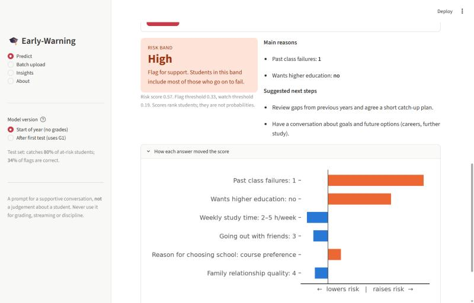
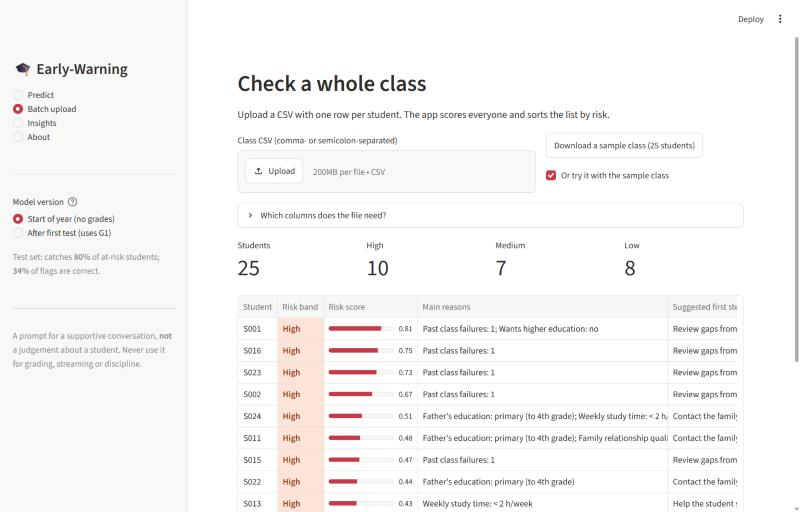
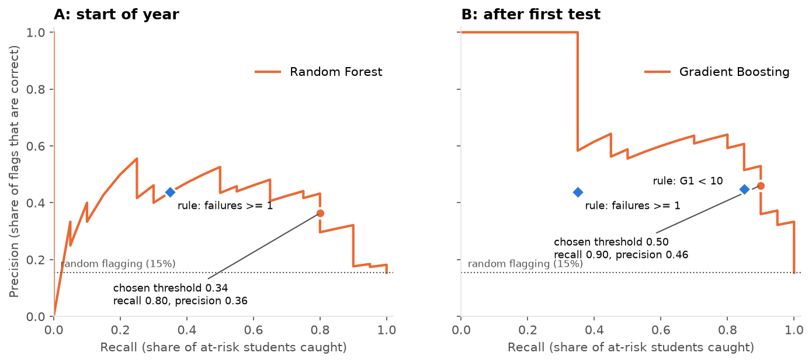
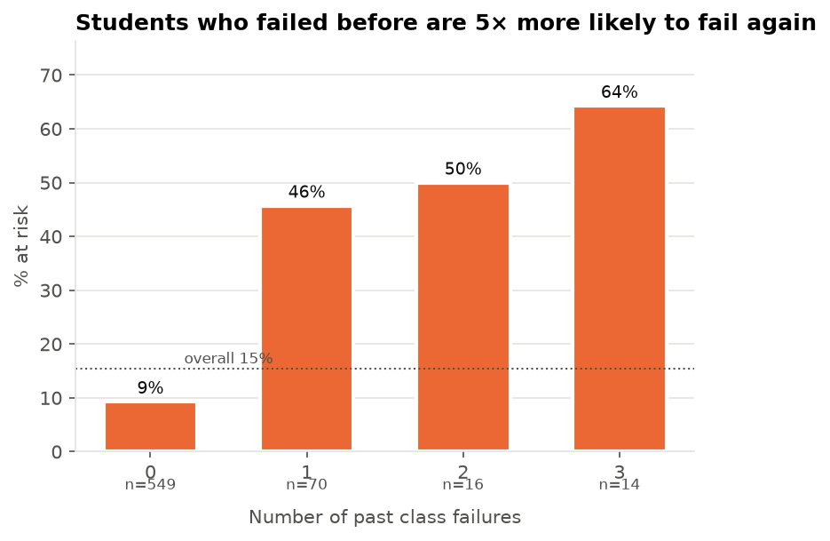
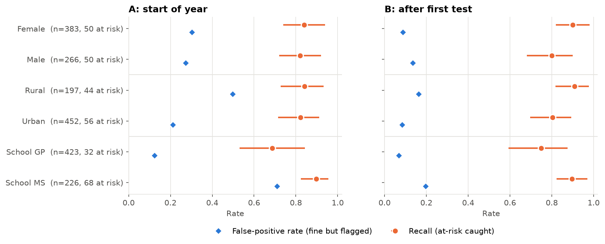

# 🎓 Student Early-Warning System

**A machine-learning tool that flags secondary-school students at risk of failing early enough for a teacher to step in, and explains *why* each student is flagged.**

🔗 **[Live demo](https://student-early-warning-system-il3vtkvaxcawxm8fhk7q96.streamlit.app/)** · 📓 [EDA](notebooks/01_eda.ipynb) · [Modelling](notebooks/02_modelling.ipynb) · [Explainability & fairness](notebooks/03_explainability_fairness.ipynb)

| Check one student | Check a whole class |
|---|---|
|  |  |

---

## 1. The problem

By the time a final grade shows a student has failed, it's too late to help. Teachers usually spot struggling students
from experience, but in large classes some are missed, especially quiet students with no history of failing.

This project asks: **using only what a school already knows, can we flag at-risk students on the first day of
term, and again after the first test, and give the teacher a reason they can act on?**

The tool supports a teacher's judgement; it doesn't replace it. A flag is a prompt for a supportive conversation,
never a label, a grade or an automated decision.

## 2. Data

[UCI Machine Learning Repository: Student Performance](https://archive.ics.uci.edu/dataset/320/student+performance) (CC BY 4.0).
**649 students** of Portuguese language at two secondary schools in Portugal (GP and MS), with 30 background, family,
study and lifestyle attributes from a questionnaire, plus three period grades (G1, G2, G3 on a 0–20 scale).

- **Target:** `at_risk = 1` if the final grade **G3 < 10** (the Portuguese pass mark). **100 students (15.4%)** are at risk.
- **15 students have G3 = 0 and zero recorded absences.** That's most likely students who left before the final exam rather than
  real zeros. They are **kept and flagged** (`no_final_exam`): a dropout is exactly what an early-warning system should catch.
  Results are re-checked without them ([robustness check](notebooks/02_modelling.ipynb)).

> P. Cortez and A. Silva. *Using Data Mining to Predict Secondary School Student Performance.* Proceedings of 5th
> FUture BUsiness TEChnology Conference (FUBUTEC 2008), pp. 5–12, Porto, Portugal, 2008.

## 3. Approach

### Two versions for two moments in the school year

| Version | Features | When a teacher can use it |
|---|---|---|
| **A: start of year** | Background, family, study habits and survey answers. **No grades, no attendance.** | Day 1 of term |
| **B: after first test** | Version A **+ first-period grade (G1)** | After the first marking period |

### What is deliberately *not* used, and why
- **G2 and G3 are never inputs.** G3 is the outcome, and G2 correlates 0.92 with it but arrives months too late to act on.
  A model using G2 would look excellent and be useless. Leakage columns are listed in code (`LEAKAGE_COLS`) and enforced by tests.
- **`absences` is excluded from Version A.** It counts the *whole* school year, so a teacher wouldn't have it on day 1.
  Tested both ways: it changed ROC-AUC by ≤ 0.01, so leaving it out costs nothing.
- **Sex, alcohol use (`Dalc`, `Walc`) and relationship status (`romantic`) are excluded from the final models.**
  Removing them changed ROC-AUC by less than 0.005 (see [Fairness](#6-explainability-and-fairness)), and a school shouldn't need this information to offer support.

### Method
- **Stratified 80/20 split** (seed 42): 519 training students, **130 held-out test students** (20 at risk), touched once at the end.
- **Stratified 5-fold cross-validation** on the training set for tuning, threshold choice and the CV columns.
- **Baselines to beat:** a dummy classifier, and one-line rules a teacher could use without any model (`failures ≥ 1`; `G1 < 10`).
- **Models:** Logistic Regression, Random Forest, Gradient Boosting (`HistGradientBoostingClassifier`) in scikit-learn
  `Pipeline` + `ColumnTransformer` (one-hot + scaling) with `class_weight="balanced"` and small hyperparameter grids.
- **Main metric: recall on the at-risk class.** Missing a struggling student costs a school year; a false alarm costs a five-minute conversation.
- **Decision threshold:** the one with the fewest false alarms that still catches **≥ 80%** of at-risk students, chosen on
  **out-of-fold** predictions, so the test set never influences a decision.

## 4. Results

**Final models used in the app** (without sensitive features), held-out test set:

| | Version A: start of year | Version B: after first test |
|---|---|---|
| Model | Random Forest | Gradient Boosting |
| **Recall** (at-risk students caught) | **0.80** (16 of 20) | **0.90** (18 of 20) |
| Precision (share of flags that are correct) | 0.34 | 0.49 |
| F1 | 0.48 | 0.63 |
| ROC-AUC | 0.81 | 0.93 |
| CV ROC-AUC (mean ± std, 5 folds) | 0.83 ± 0.05 | 0.95 ± 0.03 |
| **Best simple rule** | `failures ≥ 1`: recall **0.35**, precision 0.44 | `G1 < 10`: recall **0.85**, precision 0.45 |

<details>
<summary>Full comparison: all models and baselines (all features, before the sensitive-feature test)</summary>

| Version | Model | CV recall | CV precision | CV ROC-AUC | Test recall | Test precision | Test F1 | Test ROC-AUC |
|---|---|---|---|---|---|---|---|---|
| A: start of year | Dummy (always 'pass') | 0.00 ± 0.00 | 0.00 ± 0.00 | 0.50 ± 0.00 | 0.00 | 0.00 | 0.00 | 0.50 |
| A: start of year | Rule: failures >= 1 | 0.53 ± 0.16 | 0.51 ± 0.15 | 0.71 ± 0.10 | 0.35 | 0.44 | 0.39 | 0.63 |
| A: start of year | Logistic Regression | 0.80 ± 0.11 | 0.32 ± 0.04 | 0.79 ± 0.08 | 0.65 | 0.30 | 0.41 | 0.76 |
| A: start of year | Random Forest | 0.80 ± 0.06 | 0.37 ± 0.04 | 0.84 ± 0.06 | 0.80 | 0.36 | 0.50 | 0.81 |
| A: start of year | Gradient Boosting | 0.80 ± 0.05 | 0.33 ± 0.04 | 0.80 ± 0.05 | 0.75 | 0.28 | 0.41 | 0.78 |
| B: after first test | Rule: G1 < 10 | 0.89 ± 0.11 | 0.61 ± 0.08 | 0.89 ± 0.06 | 0.85 | 0.45 | 0.59 | 0.83 |
| B: after first test | Logistic Regression | 0.81 ± 0.10 | 0.56 ± 0.12 | 0.93 ± 0.03 | 0.85 | 0.52 | 0.64 | 0.90 |
| B: after first test | Random Forest | 0.80 ± 0.11 | 0.65 ± 0.11 | 0.94 ± 0.02 | 0.75 | 0.52 | 0.61 | 0.89 |
| B: after first test | Gradient Boosting | 0.85 ± 0.13 | 0.60 ± 0.09 | 0.94 ± 0.03 | 0.90 | 0.46 | 0.61 | 0.92 |

CV recall sits near 0.80 by design (the threshold targets it). Read CV precision and ROC-AUC instead.
With 20 at-risk test students, one student = 5 percentage points of recall. Full table incl. the `absences` variant: [`reports/results.md`](reports/results.md).
</details>



## 5. Key findings

1. **On day 1, with no grades, the model catches 80% of students who go on to fail,** versus 35% for the rule
   "flag anyone who failed before". Most at-risk students have **no** failure history, and the model finds them from a combination of smaller signals.
   The cost is about 2 false alarms per real case: acceptable for a check-in conversation, not for anything high-stakes.
2. **Once the first grade exists, a one-line rule is hard to beat.** "Flag if G1 < 10" catches 85–89% of at-risk students.
   At the same recall the model was slightly *less* precise (0.56 vs 0.60, cross-validated).
   ML's value in Version B is **ranking** students and **explaining** each flag, not finding more of them.
3. **Feature timing mattered far more than model choice.** All three models were within ~0.05 ROC-AUC of each other.
   Adding one first-period grade lifted ROC-AUC from 0.83 to 0.95.
4. **The strongest early signs:** past failures, not wanting to go on to higher education, low weekly study time, and which school the student attends.
5. **The school gap is not an urban/rural effect.** MS students fail 4× more often (30% vs 8%), but *within* each school, urban and rural
   students fail at the same rate. Rural students simply attend MS more often.



## 6. Explainability and fairness

**Explainability.** Permutation importance, logistic regression coefficients and SHAP all agree on the main drivers
(past failures, ambition, school, study time; G1 dominates Version B). In the app every flagged student gets
**their own top reasons** from SHAP, plus a suggested first step for the teacher.
Two design choices: reasons are shown only when they're real drivers for that student (≥ 25% of the top reason), which filters out
small tree-model quirks; and `school` is never shown as a "reason", because an MS teacher already knows the student is at MS.

**Sensitive-feature test.** Retraining without `sex`, `Dalc`, `Walc` and `romantic` changed CV ROC-AUC by
**−0.004 (A)** and **+0.004 (B)**, within fold-to-fold noise. **Decision: the deployed models exclude them.**

**Fairness audit** (out-of-fold predictions for all 649 students, recall with bootstrap 95% intervals):

| Group | Version A recall | Version B recall |
|---|---|---|
| Female / Male | 0.84 / 0.82 | 0.90 / 0.80 |
| Rural / Urban | 0.84 / 0.82 | 0.91 / 0.80 |
| **School GP / MS** | **0.69 / 0.90** | 0.75 / 0.90 |

- No meaningful gap by **sex** or **urban/rural** (intervals overlap heavily).
- **A real gap by school in Version A:** it catches only 69% (95% CI 53–84%) of at-risk students at GP, and flags 77% of *all* MS students
  (false-positive rate 0.71). Cause: one global threshold applied to schools with very different base rates.
  Dropping `school` closes the gap but cuts precision from 0.37 to 0.25 for everyone. The better fix is **per-school thresholds** (future work).



## 7. The app

Built with Streamlit. A model-version toggle in the sidebar switches between A and B on every page.
- **Predict:** form for one student → **risk band** (High / Medium / Low), main reasons, suggested next steps, contribution chart.
- **Batch upload:** upload a class CSV → table sorted by risk with reasons, downloadable. Row-level validation messages. A [sample class](data/sample_class.csv) of 25 held-out students is included.
- **Insights:** key charts and the model comparison.
- **About:** what the tool can and can't do.

**Risk bands, not probabilities.** Class-balanced training raises all scores (the average score is ~0.5 although only 15% fail),
so the app never says "48% chance of failing". **High** = above the flag threshold (catches ~80% / ~90% of at-risk students);
**Medium** = a "watch list" that brings recall to ~95%; **Low** = everything else.

## 8. Limitations

- **Small, specific dataset:** 649 students, two schools, one subject, one country, one school year (2005–06). Results may not transfer to
  other contexts, such as Ghanaian or US schools, without **retraining on local data**.
- **Small test set:** 20 at-risk test students, so every test metric has wide uncertainty. CV mean ± std is reported alongside.
- **Correlation, not causation:** "low study time" is associated with failing. Telling students to study more won't necessarily change the outcome.
- **Survey answers can be inaccurate:** several features are self-reported (study time, going out, ambition).
- **School-level unfairness in Version A** (section 6).
- **Not for automated decisions:** grading, streaming, discipline or anything a student can't contest.

## 9. Future work

- **Per-school (or per-class) thresholds** to close the GP/MS recall gap.
- **Retrain on local data**, e.g. Ghanaian secondary-school records, with input from teachers on which features are realistic to collect.
- **Term-by-term attendance tracking**, so attendance can be used legitimately in an early model.
- **Calibrated probabilities** (e.g. isotonic calibration) if schools need true risk estimates rather than rankings.
- **Evaluate in practice:** do flagged students who receive support actually do better?

## 10. How to run locally

```bash
git clone https://github.com/Awal-techLife/Student-Early-Warning-System.git
cd Student-Early-Warning-System
python -m venv .venv
# Windows: .venv\Scripts\activate    macOS/Linux: source .venv/bin/activate
pip install -r requirements-dev.txt     # Python 3.12

streamlit run app/streamlit_app.py      # the app
pytest                                  # 30 tests
```

**Reproduce every result** (deterministic, seed 42; raw data is included in `data/raw/`):

```bash
python -m src.data        # load + clean, prints a sanity summary
python -m src.train       # baselines, 3 models, CV, test results -> reports/, models/
python -m src.fairness    # sensitive-feature test, fairness audit, final app models
jupyter nbconvert --to notebook --execute --inplace notebooks/*.ipynb
```

<details>
<summary>Project structure</summary>

```
├── app/streamlit_app.py        # Streamlit app (UI only)
├── src/
│   ├── data.py                 # load, validate, clean, target, leakage list
│   ├── features.py             # feature sets for Version A / A+absences / B
│   ├── train.py                # split, CV, baselines, tuning, thresholds, evaluation
│   ├── explain.py              # permutation importance, coefficients, SHAP
│   ├── fairness.py             # group audit + sensitive-feature test
│   └── predict.py              # validation, risk bands, reasons, actions (used by the app)
├── notebooks/                  # 01 EDA · 02 modelling · 03 explainability & fairness
├── models/                     # saved pipelines (.joblib)
├── reports/                    # results tables + figures
├── data/raw/                   # original UCI CSVs
├── data/sample_class.csv       # example class for the batch page
└── tests/                      # 30 pytest tests (leakage, scoring, validation, SHAP)
```
</details>

## 11. Author

**Awal Abdullah N-don**: trained IT teacher, now working in data science. This project brings together classroom
experience (what a teacher can realistically know, and what a flag should lead to) and the full ML workflow:
data cleaning, EDA, modelling, evaluation, explainability, fairness and deployment.

GitHub: [@Awal-techLife](https://github.com/Awal-techLife)

License: [MIT](LICENSE)
